# Azure Windows Server Administration Lab

**Network security, VM deployment, and out-of-band troubleshooting on Microsoft Azure**

In this hands-on lab I secured an Azure virtual network with application and network security groups, deployed two Windows Server 2025 VMs, and used the Azure Serial Console to configure the Windows boot environment with `bcdedit`.

## Skills Demonstrated

- **Network security:** application security groups (ASGs), network security groups (NSGs), and inbound rule design
- **Compute:** deploying and configuring Windows Server 2025 Datacenter VMs
- **Role-based traffic control:** associating VM network interfaces with ASGs so rules follow workload role instead of IP address
- **Diagnostics and recovery:** boot diagnostics, storage account configuration, and Azure Serial Console access
- **Windows administration:** boot configuration through `bcdedit` (boot menu, timeout, Emergency Management Services)

**Tools and technologies:** Azure Portal, Azure Virtual Machines, Azure Virtual Network, Azure Storage, Azure Serial Console, Windows Server 2025, Command Prompt

## Environment

| Resource | Configuration |
| --- | --- |
| Resource group / region | RG1 / East US 2 |
| Virtual network / subnet | MyVNet / MySubnet (10.0.0.0/24) |
| Application security groups | WebServers, MgmtServers |
| Network security group | MyNSG, associated with MySubnet |
| Virtual machines | VM1, VM2 (Windows Server 2025 Datacenter, Standard_B2ls_v2) |
| Storage account | Boot diagnostics storage for VM1 |

---

## Part 1: Network Security

### 1. Create application security groups
I created two ASGs, **WebServers** and **MgmtServers**. ASGs let me group VMs by function and write NSG rules against the group, so rules don't have to be rewritten as VMs are added or removed.

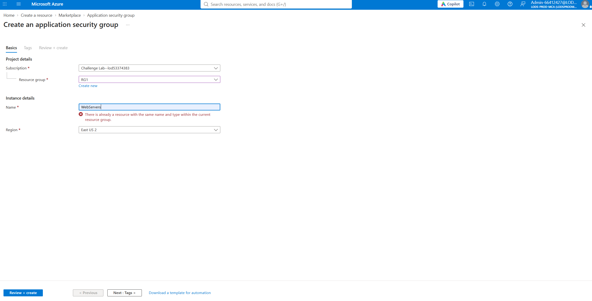


### 2. Create the network security group
I created **MyNSG** to filter traffic at the subnet level. New NSGs start with default rules that allow traffic within the virtual network and deny other inbound traffic, so anything else has to be explicitly allowed.

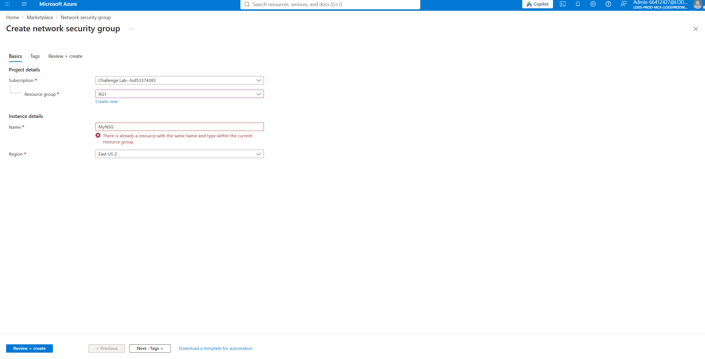

### 3. Associate the NSG with the subnet
I associated MyNSG with **MySubnet** so every VM in that subnet is covered by the same rule set.

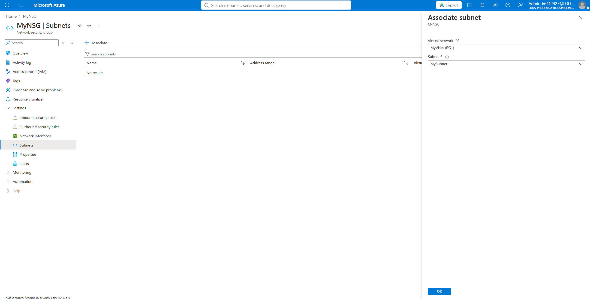

### 4. Create inbound security rules
NSG rules are evaluated by priority, and the first match wins. I created two:

| Rule | Protocol | Ports | Target |
| --- | --- | --- | --- |
| Allow-Web-All | TCP | 80, 443 | WebServers ASG |
| Allow-RDP-All | TCP | 3389 | MgmtServers ASG |

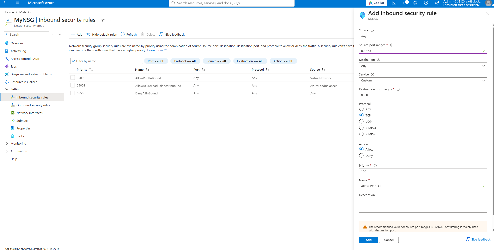


---

## Part 2: Virtual Machine Deployment

### 5. Deploy VM1
I deployed **VM1** with Windows Server 2025 Datacenter (x64 Gen2), size Standard_B2ls_v2, the Standard security type, and no infrastructure redundancy, in MyVNet / MySubnet.

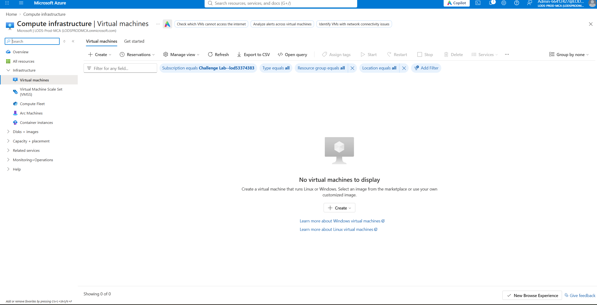
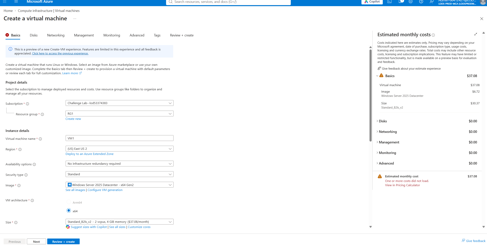
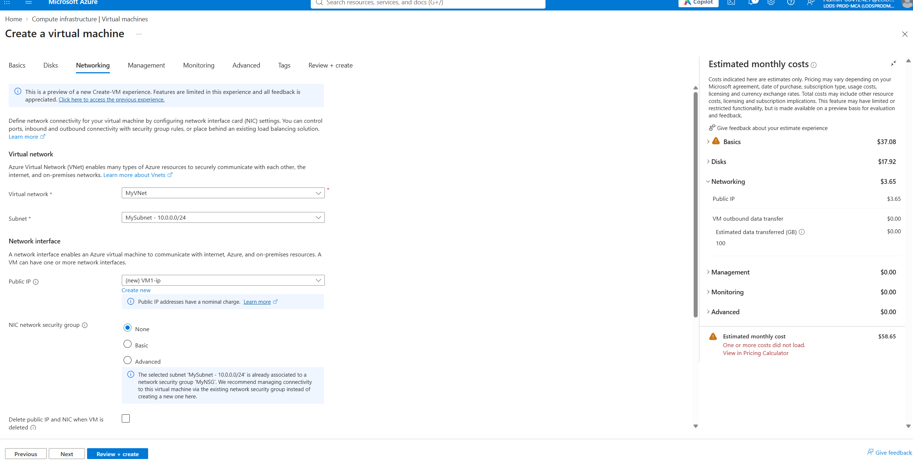
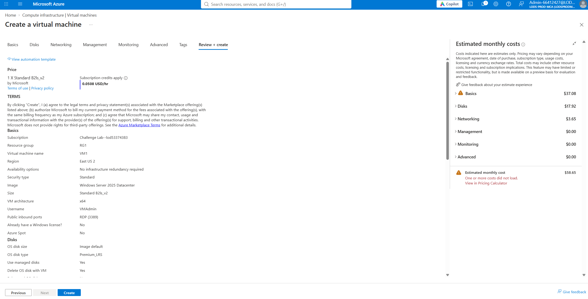
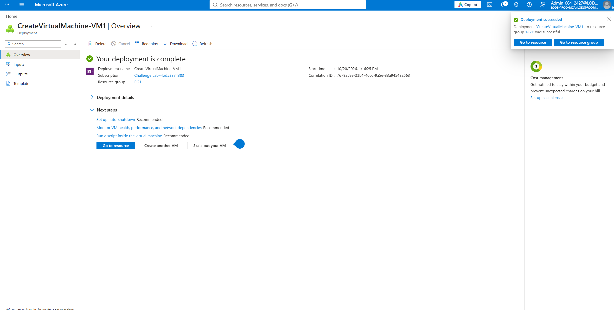

### 6. Deploy VM2
I deployed **VM2** with the same image, size, region, and network placement, and opened inbound HTTP (80), HTTPS (443), and RDP (3389) in the setup wizard.

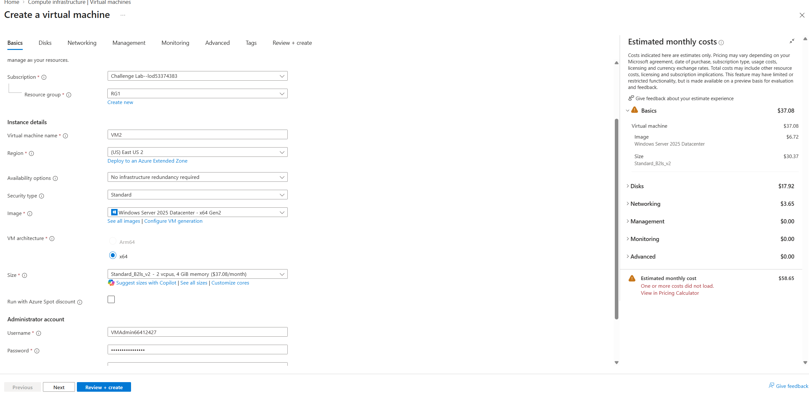
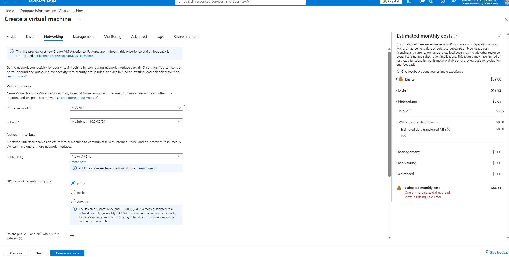
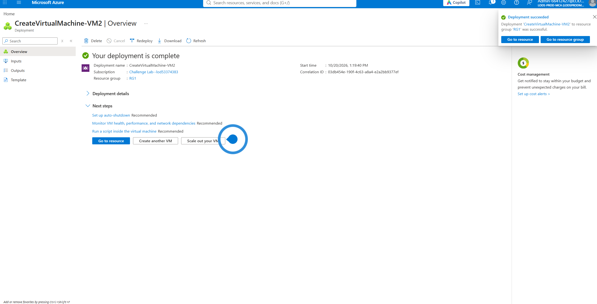

### 7. Assign VMs to application security groups
I added VM1's network interface to the **WebServers** ASG, so the web rule applies to it. The portal confirmed the NIC update. VM2's interface appears in the **MgmtServers** ASG.

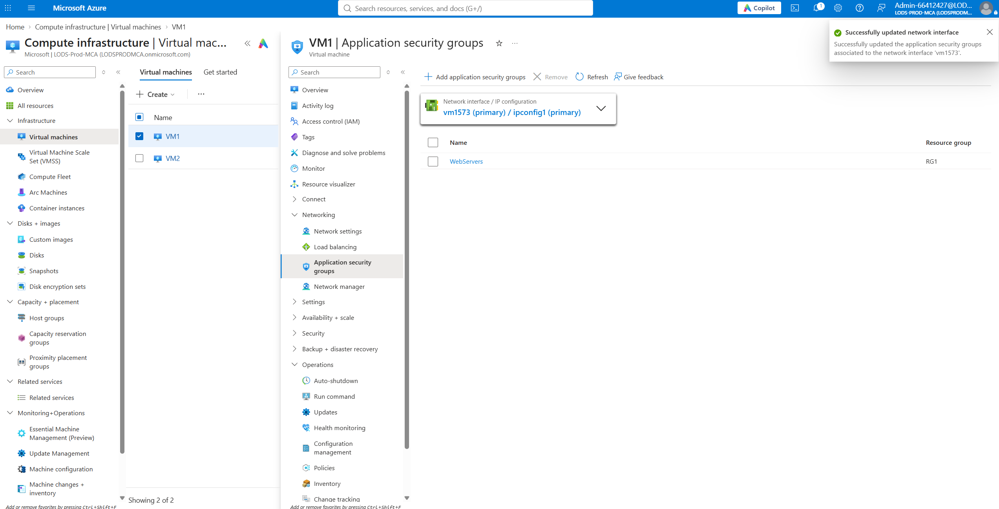
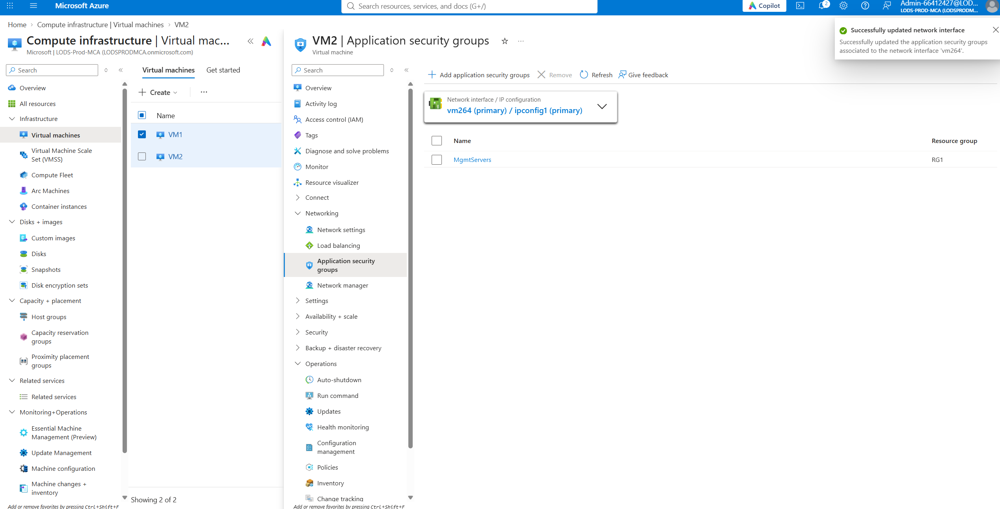

---

## Part 3: Boot Diagnostics and Serial Console

### 8. Create a storage account
The Azure Serial Console requires boot diagnostics, and boot diagnostics requires a storage account. I created one in RG1 (East US 2) with Blob Storage / Data Lake Storage Gen2 as the primary service.

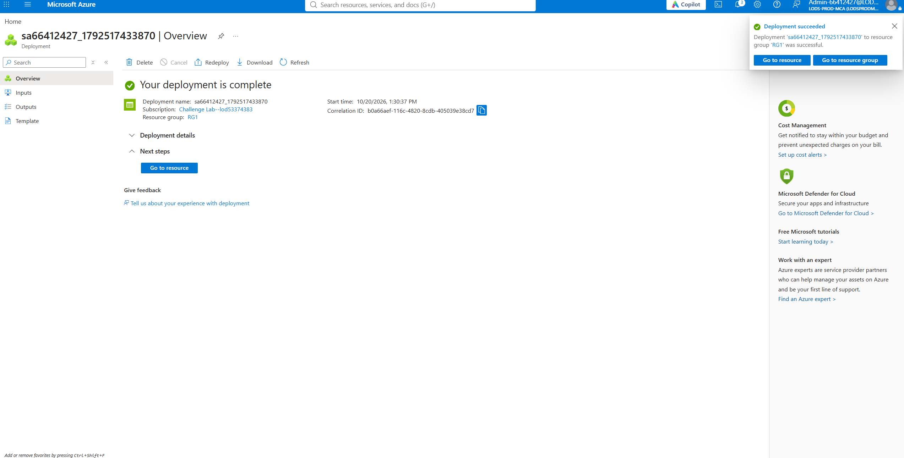

### 9. Enable boot diagnostics and open the serial console
I enabled boot diagnostics on VM1 using the new storage account, then opened the Serial Console and created a channel running a CMD instance. The serial console gives out-of-band access to a VM even when RDP or the network isn't working.


### 10. Configure the boot manager with bcdedit
From the serial console I ran:

```
bcdedit /set {bootmgr} displaybootmenu yes
bcdedit /set {bootmgr} timeout 20
bcdedit /set {bootmgr} bootems yes
bcdedit /enum {bootmgr}
```

The `/enum` output confirmed the boot menu is displayed, the timeout is 20 seconds, and Emergency Management Services (EMS) is enabled. EMS is what allows console-level management of a Windows system during startup.

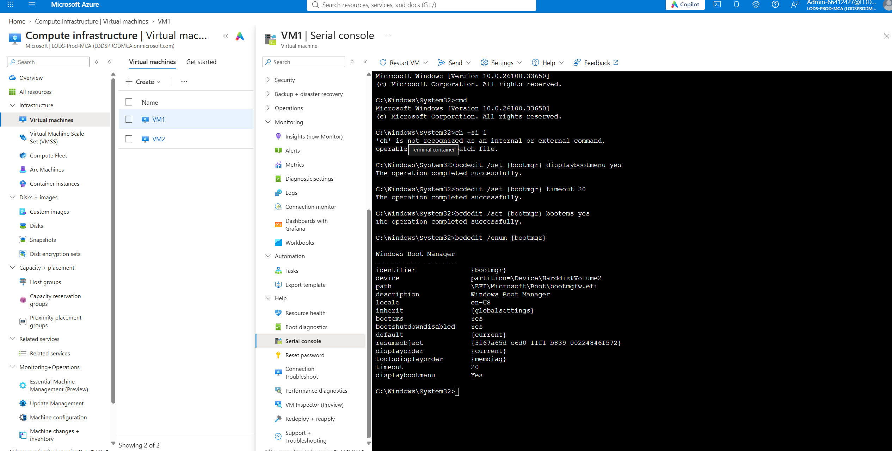

---

## Key Takeaways

- ASGs keep NSG rules readable and scalable, because rules describe roles ("WebServers") instead of individual IP addresses.
- Managing access at the subnet-level NSG avoids scattered, hard-to-audit NIC-level rules.
- NSG behavior depends on rule priority and the default deny, so rules must be scoped carefully, especially for management ports like RDP.
- Boot diagnostics and the Serial Console give a recovery path into a VM that has lost network connectivity, but they must be set up before they are needed.

## Notes

- This lab was completed in a temporary, instructor-provided Azure environment, and the resources no longer exist.
- Credentials and tenant-specific details are intentionally left out of this write-up.
